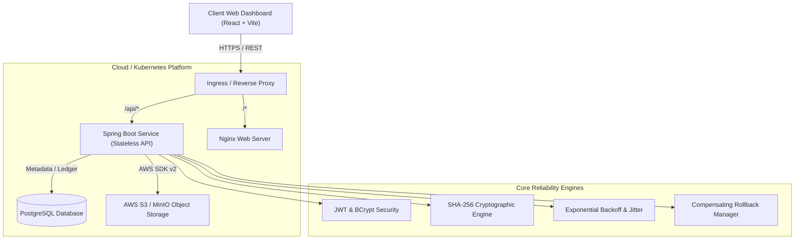
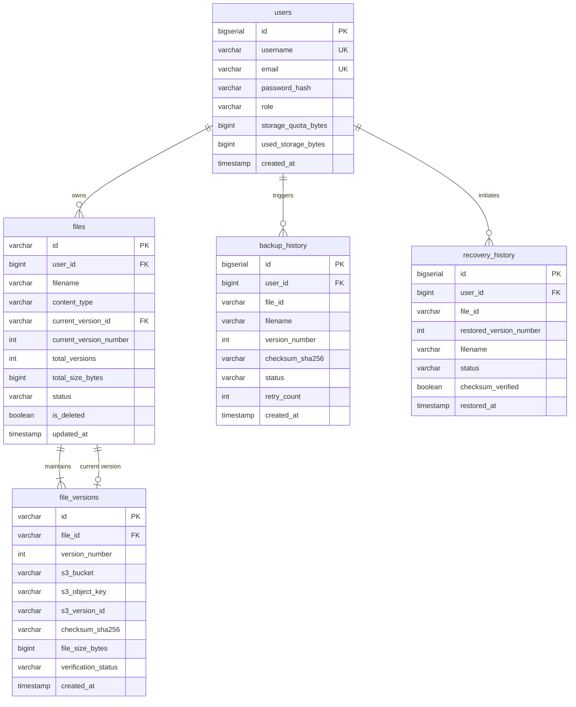

# Distributed Cloud Backup & Recovery Platform

[](https://spring.io/projects/spring-boot)
[](https://www.oracle.com/java/)
[](https://aws.amazon.com/sdk-for-java/)
[](https://www.postgresql.org/)
[](https://react.dev/)
[](https://docs.docker.com/compose/)
[](https://kubernetes.io/)

An enterprise-grade, distributed cloud backup and disaster recovery platform engineered with **Java 17 Spring Boot 3**, **React 18 with Vite**, **PostgreSQL**, **AWS S3 / MinIO**, and **Kubernetes**.

This platform demonstrates real-world cloud engineering principles: **cryptographic SHA-256 integrity verification**, **immutable append-only versioning**, **distributed 2-phase compensating rollbacks**, **exponential backoff retry resilience**, **stateless JWT multi-tenancy**, and **container orchestration**.

---

## Architecture Overview



---

## Core Features & Cloud Engineering Concepts

### 1. Secure Multi-Tenant Authentication (JWT & BCrypt)
- **BCrypt password hashing** with configurable work factor (cost 12).
- **Stateless JWT authentication** with HMAC-SHA256 signature verification.
- **Tenant isolation:** Strict user-level partitioning. Users can only query, upload, verify, or recover their own files.

### 2. Resilient Cloud Backup Engine (AWS S3 SDK v2)
- Direct streaming to **AWS S3** with dual-layer versioning (S3 native bucket versioning + application-level version catalog).
- **Deterministic S3 Key Partitioning:** `users/{userId}/files/{fileId}/v{versionNumber}/{filename}`.
- **Compensating Rollbacks:** If a database transaction fails after an S3 upload, a compensating S3 `DeleteObject` cleanup is automatically dispatched, preventing orphaned blobs.
- **Resilience Policy:** Exponential backoff with randomized jitter handles transient network glitches and S3 `503 SlowDown` responses.
- **Idempotency Guard:** Detects whether uploaded bytes match the active version's SHA-256 hash, rejecting redundant uploads and saving cloud storage costs.

### 3. Immutable File Versioning Lineage
- **Append-only ledger:** Historical versions are never overwritten or mutated.
- Uploading an updated file automatically increments version (`v1` $\rightarrow$ `v2` $\rightarrow$ `v3`).
- Tracks version numbers, timestamps, file sizes, S3 object keys, and cryptographic hashes.

### 4. Cryptographic Integrity Verification (SHA-256)
- Streams object bytes directly from cloud storage and computes live SHA-256 checksums on the fly.
- Compares computed checksum against the immutable database signature to detect bit rot, truncation, or unauthorized tampering.
- Flags corrupted files with visible status indicators (`VERIFIED` vs `CORRUPTED`).

### 5. Disaster Recovery & Rollback Engine
- Allows users to restore any previous version at any point in time.
- **Pre-recovery verification:** Recalculates cryptographic integrity before promoting or delivering restored files, preventing recovery of corrupted snapshots.
- Maintains comprehensive audit history in `recovery_history`.

---

## Database Schema (PostgreSQL)



---

## Quick Start (3 Ways to Run)

### Option 1: 1-Click Instant Launcher (Windows)
A zero-dependency self-contained runner is provided. Double-click **`run.bat`** (or execute `.\run.bat` / `.\run.ps1` in PowerShell):
- Automatically starts the microservice on `http://localhost:8080`.
- Launches your default browser directly into the web dashboard.
- Uses built-in mock S3 object storage in `./data/s3_storage` and an embedded database ledger.
- **Default Login Credentials:**
  - **Username:** `cloud_architect`
  - **Password:** `SecurePassword123!`

### Option 2: 1-Command Docker Compose (Full Cloud Stack)
Launches PostgreSQL, MinIO S3 (with automated bucket initialization and versioning enablement), the Spring Boot backend, and the React frontend:

```bash
docker compose up --build
```

Access URLs:
- **Web Dashboard:** [http://localhost:3000](http://localhost:3000)
- **REST API:** [http://localhost:8080](http://localhost:8080)
- **MinIO Cloud Storage Console:** [http://localhost:9001](http://localhost:9001) (`minioadmin` / `minioadmin`)

### Option 3: Standalone Interactive HTML (Zero Setup)
Double-click [`standalone_dashboard.html`](standalone_dashboard.html) in your file explorer to open the dashboard directly in Chrome or Edge.

---

## Running with Kubernetes Orchestration

Production-ready Kubernetes manifests are provided under `k8s/`:

```bash
# 1. Create namespace
kubectl apply -f k8s/00-namespace.yaml

# 2. Apply secrets & configmap
kubectl apply -f k8s/01-secrets.yaml
kubectl apply -f k8s/02-configmap.yaml

# 3. Deploy persistent storage and databases
kubectl apply -f k8s/03-postgres.yaml
kubectl apply -f k8s/04-minio-s3.yaml

# 4. Deploy Backend with HPA and Frontend
kubectl apply -f k8s/05-backend.yaml
kubectl apply -f k8s/06-frontend.yaml

# 5. Apply Ingress router
kubectl apply -f k8s/07-ingress.yaml
```

To verify Kubernetes pods and health probes:
```bash
kubectl get pods -n cloud-backup
kubectl get hpa -n cloud-backup
```

---

## Local Development (Without Docker)

### 1. Backend Setup
**Prerequisites:** JDK 17+ and PostgreSQL.

```bash
cd backend

# Run embedded tests
./mvnw test

# Start the Spring Boot application
./mvnw spring-boot:run
```

### 2. Frontend Setup
**Prerequisites:** Node.js 18+.

```bash
cd frontend

# Install dependencies
npm install

# Start development server with proxy to backend
npm run dev
```

Visit [http://localhost:5173](http://localhost:5173).

---

## REST API Reference Summary

| Method | Endpoint | Description | Access |
|---|---|---|---|
| `POST` | `/api/auth/register` | Register new user with hashed password & JWT | Public |
| `POST` | `/api/auth/login` | Authenticate and issue JWT token | Public |
| `GET` | `/api/auth/me` | Fetch authenticated profile & storage quota | Authenticated |
| `POST` | `/api/files/upload` | Upload & backup file (auto-creates next version) | Authenticated |
| `GET` | `/api/files` | List user files (with optional `?search=...`) | Authenticated |
| `GET` | `/api/files/{id}` | Get metadata for specific file | Authenticated |
| `GET` | `/api/files/{id}/versions` | Get complete version history for a file | Authenticated |
| `POST` | `/api/files/{id}/verify` | Cryptographic SHA-256 verification against S3 | Authenticated |
| `POST` | `/api/files/{id}/restore/{versionId}` | Restore previous version with pre-recovery check | Authenticated |
| `GET` | `/api/files/{id}/download` | Stream download active file or specific version | Authenticated |
| `GET` | `/api/backup/history` | Audit trail of all backup events & retries | Authenticated |
| `GET` | `/api/recovery/history` | Audit trail of all restore actions & verifications | Authenticated |
| `GET` | `/api/dashboard/stats` | Aggregated dashboard metrics & recent logs | Authenticated |

For detailed request/response schemas, see [docs/API_DOCUMENTATION.md](docs/API_DOCUMENTATION.md).

---

## Testing & Quality Assurance

### Automated Backend Tests
Unit and integration test suites cover:
- **Authentication & BCrypt:** User registration, credential matching, duplicate rejection (`AuthServiceTest.java`).
- **File Upload & Versioning:** S3 upload, version incrementation, idempotency check, quota enforcement, compensating rollback (`FileBackupServiceTest.java`).
- **Cryptographic Integrity:** Matching hashes, simulated S3 bit rot corruption detection, missing object handling (`IntegrityVerificationTest.java`).
- **Disaster Recovery:** Pre-recovery integrity verification, version promotion, abort on corrupted blob (`RecoveryServiceTest.java`).
- **SHA-256 Engine:** Known hash validation and stream verification (`ChecksumUtilsTest.java`).

Run tests locally:
```bash
cd backend
./mvnw test
```

### Postman Test Suite
Import `postman/Distributed_Cloud_Backup_Platform.postman_collection.json` into Postman.  
Detailed execution guide: [docs/POSTMAN_GUIDE.md](docs/POSTMAN_GUIDE.md).

---

## Portfolio & Interview Highlights

When discussing this project during software engineering or cloud engineering interviews, highlight:

1. **Distributed Systems Reliability:**
   - How 2-phase compensating rollbacks solve the dual-write problem between PostgreSQL and AWS S3.
   - Why exponential backoff with jitter prevents thundering herd issues on cloud storage APIs.
2. **Data Integrity & Security:**
   - Why storing streaming SHA-256 checksums during upload enables tamper-evident bit rot detection.
   - Why pre-recovery integrity verification is vital to prevent restoring corrupted or truncated snapshots.
   - User-partitioned multi-tenancy and stateless JWT authorization.
3. **Cloud Native Orchestration:**
   - Kubernetes liveness and readiness health probes tied to Spring Boot Actuator.
   - Horizontal Pod Autoscaler (HPA) responding to traffic spikes.
   - Multi-stage Docker builds minimizing production image attack surfaces.
