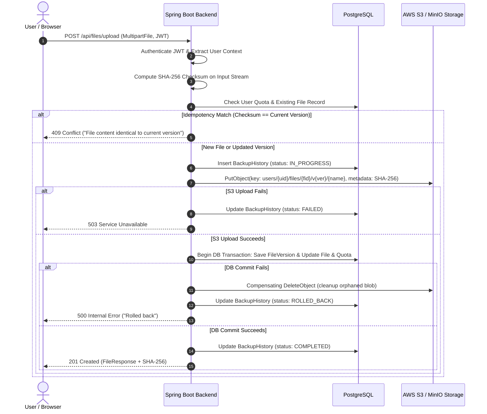
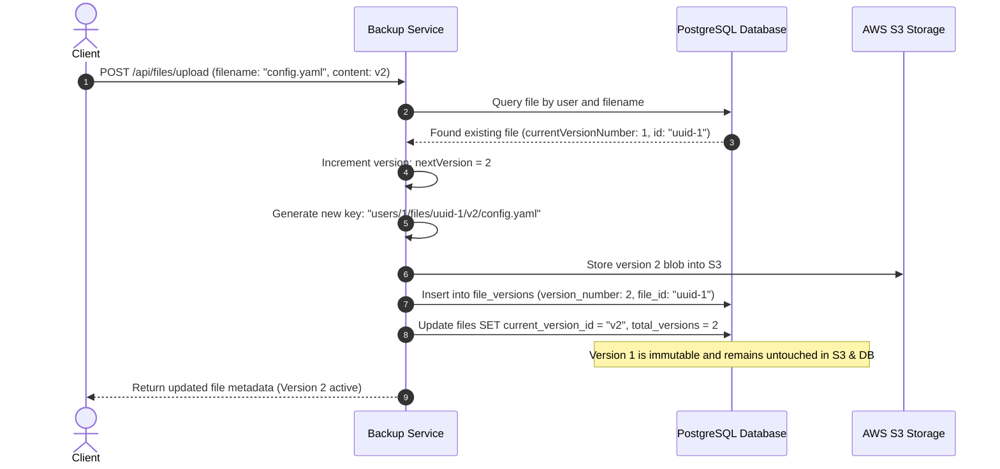
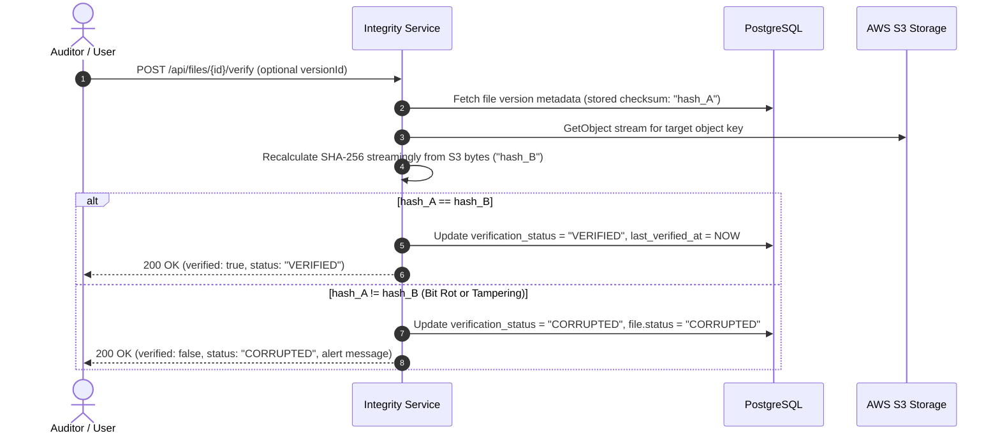
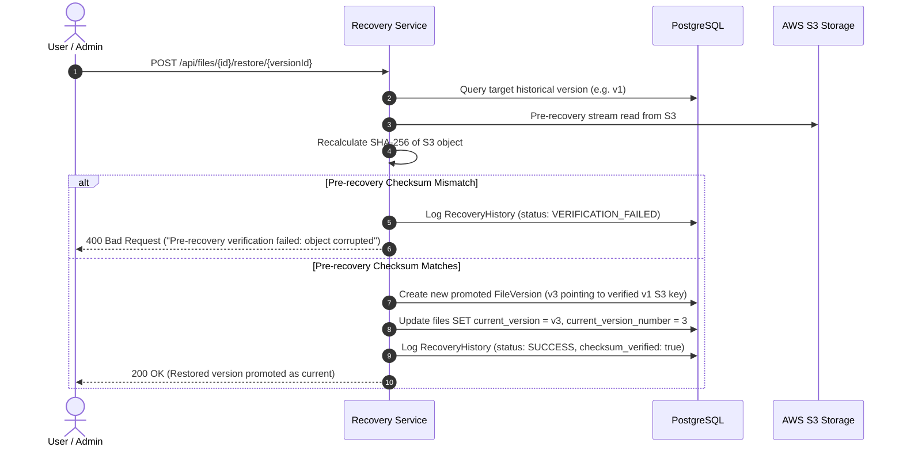

# Platform Workflows & Sequence Diagrams

## 1. File Upload & Backup Workflow

---

## 2. File Versioning Workflow

---

## 3. Cryptographic Integrity Verification Workflow

---

## 4. Disaster Recovery & Restore Workflow

